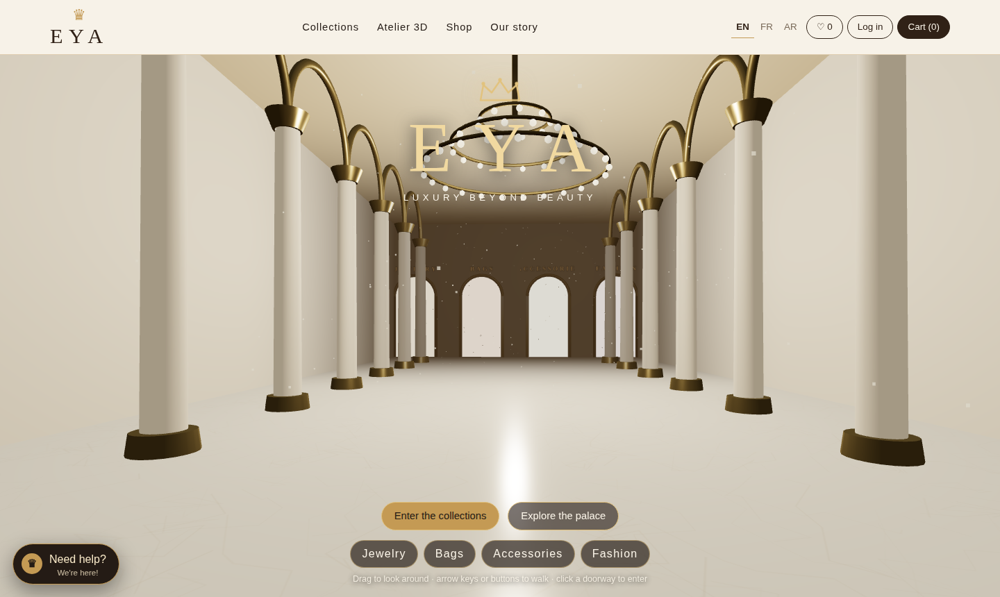
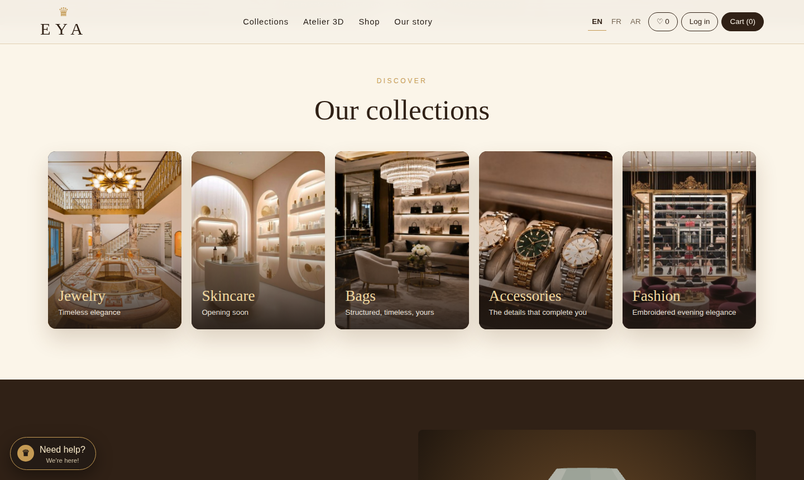

# EYA — Luxury Beyond Beauty

An immersive luxury e-commerce storefront with a 3D palace entrance, boutique departments, a shopping cart, accounts, an admin panel and a multilingual interface (English, French, Arabic with right-to-left layout).



## Features
- **3D palace hero** built with Three.js: marble hall, colonnade, chandelier, drifting gold dust. Drag to look around, use the arrow keys or buttons to walk, click a doorway to enter a boutique. Respects `prefers-reduced-motion` and falls back to a photo when WebGL is unavailable.
- **Boutique departments:** Jewelry, Bags, Accessories, Fashion (Skincare and Fragrance are planned).
- **Shop:** category filters, search, sorting, product detail dialog, stock and availability, wishlist.
- **Cart and checkout:** quantities, totals, removal. Prices, totals and stock are always computed on the server.
- **Accounts and admin:** registration and login (hashed passwords), order history, and an admin view to edit price and stock and update order status.
- **EYA Concierge:** a rule-based shopping assistant that searches the catalog ("handbag under 200"). It does not use an external AI service.
- **Accessible and responsive:** keyboard navigation, focus styles, ARIA labels, layouts for desktop, tablet and mobile.

| Boutiques | Shop | Concierge |
|---|---|---|
|  |  |  |

## Tech stack
Python 3 · Flask · SQLite · vanilla JavaScript · Three.js r128 (CDN) · pytest

## Run locally (Windows PowerShell)
```powershell
git clone <your-repo-url>
cd eya-luxury-store
python -m pip install -r requirements.txt
$env:ADMIN_PASSWORD="choose-a-strong-one"
$env:SECRET_KEY="any-long-random-text"
python app.py
```
Open http://127.0.0.1:5000. macOS/Linux: use `export` instead of `$env:`.
Admin login: `admin@aurelle.test` with your `ADMIN_PASSWORD` (the email is kept for database compatibility).

## Project structure
```
app.py              Flask app factory, API routes, database schema
wsgi.py             Entry point for hosting
catalog.json        Product data (EN/FR/AR)
static/index.html   Storefront (HTML, CSS, JS)
static/assets/      palace.js (3D scene), palace.css, assistant.js (concierge)
static/img/         Product and boutique photos
tests/              pytest suite
docs/screenshots/   README images
```

## API (JSON)
`GET /api/products?q=&category=&sort=` · `GET/POST /api/cart` · `POST /api/register` · `POST /api/login` · `POST /api/logout` · `GET /api/me` · `POST /api/checkout` · `GET /api/orders` · admin: `GET /api/admin/orders`, `PATCH /api/admin/orders/<id>`, `PATCH /api/admin/products/<id>`

## Tests
```powershell
python -m pytest -q
```
Covers catalog search and sorting, server-side totals, stock control, input validation, role permissions and translations.

## Deploy
Set the environment variables `ADMIN_PASSWORD` and `SECRET_KEY` on your host. Use `wsgi.py` (`application`) on PythonAnywhere, or `gunicorn wsgi:app` (see `Procfile`) on other hosts. Set `EYA_DB` to a path on persistent storage so orders survive restarts. Serve over HTTPS.

## Editing the catalog
Edit `catalog.json` and the photos in `static/img/`, then delete `eya.db` and restart to reload.

## Known limitations
- Payments are not connected: checkout records the order and takes no money.
- No rate limiting or email confirmations yet.
- Skincare and Fragrance departments need product data and photos.
- Delivery and returns policies in the concierge are placeholders.
- Photos must be properly licensed before commercial use; check the rights to every image in `static/img/`.

## Roadmap
3D boutique rooms per department · 3D product viewer · real payments · skincare and fragrance catalog · email notifications.

## Development and credits
Designed and developed by **<Your Name>**. Built with AI assistance (Claude, by Anthropic) for code generation and iteration; design direction, content, photo selection and testing by the project owner.
Three.js is MIT licensed.
